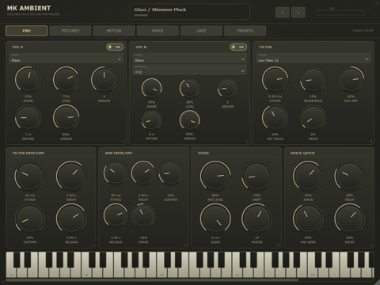

# MK Ambient

An epic, spacious ambient synthesizer built for **iPadOS 17 (AUv3 / touch-first)**: lush analog pads,
cinematic swells, deep drones and four independently moving noise/texture layers.

The audio engine is portable C++17 with **no third-party DSP dependencies**, so every part of
the sound can be compiled, rendered and measured on any host. A thin JUCE layer provides the
AUv3 / Standalone / VST3 wrapper and the touch-first interface.

This repository holds two independent products, each with its own build tree:

| folder | what | licence |
|---|---|---|
| repository root | **MK Ambient** — the ambient synth documented below | AGPL-3.0 ([LICENSE](LICENSE)) |
| [`MK RATTUS TRANCE GATE/`](MK%20RATTUS%20TRANCE%20GATE/) | **MK RATTUS TRANCE GATE** — a standalone rhythmic gating effect with editable Gate12 curves | GPL-3.0 ([LICENSE](MK%20RATTUS%20TRANCE%20GATE/LICENSE)) |

They do not share code: the gate in MK Ambient ([`Source/DSP/TranceGate.*`](Source/DSP/TranceGate.h))
is an original 12-step amp sequencer, while MK RATTUS TRANCE GATE links the GPL-3.0
[Gate12](https://github.com/tiagolr/gate12) curve engine. Each folder builds on its own —
`cmake -S .` for the synth, `cmake -S "MK RATTUS TRANCE GATE"` for the gate.

---

## What it is

* **Pad voice** — two morphing, band-limited wavetable oscillators (up to 7 unison voices each),
  per-voice analog drift, stereo multimode filter with its own envelope, curved ADSR amp
  envelope, glide, 1–16 voices.
* **4-layer texture engine** — each slot has its own source, filter, LFO, pan, drive, swell and
  delay/space sends. Sources are six procedural noise colours plus **132** short textures in six
  families (crackle, vinyl, tape, foley, granular, city). Slots support loop, one-shot and
  granular-cloud playback.
* **Movement** — three slow global LFOs (sine, triangle, ramps, square, sample & hold, smooth
  random) routed to filter cutoff, detune, wavetable morph, pan and space, plus a dedicated LFO
  per texture slot.
* **Space & tone** — ensemble width, free-time (ms) stereo delay with ping-pong and damping, an
  8-line feedback-delay-network reverb with diffusion, pre-delay, damping and width, master
  saturation, low cut and a 2 ms look-ahead limiter. All effect returns are high-passed so the
  low end stays tight.
* **12-step trance gate** — tempo-synced amplitude sequencer with a touch-editable step curve,
  eight pattern shapes, paint/point editing, snap, undo, Min/Max/Tension shaping, independent
  attack and release, phase offset, and Sync / Free / Note triggering. Targets the pad, the
  textures or both.
* **Touch-first UI** — monochrome olive-gray hardware look, 80 px+ knobs with vertical drag,
  fine drag on shift, double-tap to reset defaults, grouped source menus, 30 Hz metering. The
  whole interface is laid out once at 1200 × 900 and **scaled to fit** whatever the window or
  AUv3 host gives it, so nothing is ever clipped; on/off switches in every card header bypass
  the oscillators, texture slots, LFOs, delay, reverb, ensemble and gate.
* **On-screen keyboard** — a small piano roll along the bottom of the editor (C1–C7, horizontal
  scroll bar) for playing the synth straight from the plug-in: multi-touch chords, glissando,
  and note labels on every C. It stays visible on all pages and feeds the engine through a
  lock-free FIFO, so it is safe with the audio thread.

**101 host programs: `Init` plus 100 ambient presets**, including the five flagship patches
(*Submerged Drone*, *Distant Rain / Wind Pad*, *Worn Tape Chord*, *Glass / Shimmer Pluck*,
*Evolving Granular Texture*).

---

## Interface



**It scales.** The editor is designed once on a 1200 × 900 (4:3, iPad) canvas and that canvas
is transformed to fit the window or the AUv3 host view, so a 640 × 480 window, Split View on an
iPad and a full 12.9" screen all show the complete interface — same layout, same proportions, no
clipped control. Desktop windows resize with a locked 4:3 aspect; hosts may hand the editor any
size and the spare space is letterboxed.

**Every section can be switched off** from the header of its card:

| switch | card | what it bypasses |
|---|---|---|
| `Osc A On` / `Osc B On` | OSC A, OSC B | that oscillator's level (the other one keeps sounding) |
| `Slot 1 On` … `Slot 4 On` | SLOT 1–4 | that texture layer's output and sends |
| `LFO 1 On` … `LFO 3 On` | LFO 1–3 | that LFO's modulation output |
| `Delay On` | STEREO DELAY | the delay return |
| `Space On` | SPACE REVERB | the reverb return |
| `Ensemble On` | WIDTH & MASTER | the ensemble/chorus width |
| `Gate On` | GATE | the trance-gate mix (pattern and steps keep their values) |

Each switch is an ordinary automatable parameter (`oscAOn`, `slot3On`, …) that defaults to on and
is smoothed over 15 ms, so switching fades instead of clicking, and presets or existing sessions
keep the old sound. Because it scales the section's own gain, a switch never resets the controls
behind it — flip it back and the patch is exactly as it was.

**Play it from the plug-in.** A small keyboard sits along the bottom of the editor on every page:
73 keys from C1 to C7 at 34 px per white key, with a horizontal scroll bar (and mouse-wheel /
trackpad scrolling) whenever the range is wider than the window. Touching slides between keys
(glissando), each finger holds its own note for chords, and the C keys are labelled. Notes go
through `PluginProcessor::keyboardNoteOn/Off` into a lock-free FIFO that is merged into the MIDI
stream on the audio thread, so the sustain pedal, gate triggering and voice stealing all behave
exactly as with an external controller.

---

## Trance gate (GATE page)

A 12-step amplitude sequencer that can chop the pad, the textures or both. Off by default
(`Gate Mix = 0`), so every factory program keeps its original sound.

**Sequencer**

| control | range | notes |
|---|---|---|
| Gate Mix | 0–100% | dry/wet of the gating; 0 is a true bypass |
| Trigger | Sync / Free / Note | host tempo, a free Hz rate, or restart on every note-on |
| Pattern Length | 2 Bars … 1/16 | 12 steps per pattern, so 1 bar = one step per triplet eighth |
| Free Rate | 0.05–20 Hz | pattern rate when Trigger is Free or Note |
| Phase | 0–100% | playhead offset (restarts the pattern where you drop it) |
| Min / Max | 0–100% | maps the step values into a level window |
| Attack / Release | 1 ms – 2 s | ramp time into a step, separately for rising and falling |
| Tension | −100…+100% | bends the ramp (fast start ↔ slow start) |
| Gate Target | Pad / Textures / Both | which bus is gated |
| 12 × Step | 0–100% | per-step level |

**Editing (touch first)**

* **Point** mode: drag a node vertically to set that step.
* **Paint** mode: drag horizontally to paint one level across several steps.
* **Snap** quantises edits to a 1/16 grid; double-tap a node jumps it to full.
* **Eight pattern shapes** (ramp up, ramp down, triangle, all-on, classic 16th, alternating,
  sine, stutter) load with one tap; **Flip X** mirrors, **Random** scatters musically,
  **Min**/**Max** flatten the pattern, **Undo**/**Redo** step through the last 32 edits.
* The curve is drawn by the same function the DSP runs, so the preview matches the audio to
  within 0.011 (measured).

**Timing** — in Sync mode the gate follows the host tempo and transport; the standalone and any
host without a playhead fall back to 120 BPM, so it always runs.

---

## Preset bank

The five flagship patches come first, followed by 95 more generated from 20 designed families
with five variations each:

| category | programs | families |
|---|---|---|
| Deep Drone | 15 | Submerged, Abyssal, Glacier |
| Cinematic Pad | 15 | Cathedral, Horizon, Aurora |
| Analog Pad | 10 | Velvet, Strings |
| Formant Pad | 5 | Choir |
| Lo-Fi Pad | 10 | Worn Tape, Ember |
| Atmosphere | 20 | Rainfield, Wind Tunnel, Ocean, Night City |
| Texture | 15 | Fog Bank, Machine Room, Granular |
| Shimmer | 10 | Bell Garden, Crystal |

Every family defines a complete patch — oscillators, filter, both envelopes, three LFOs, up to
four texture slots and the effect sends. Each of its five variations applies a *mood*:

| variation | cutoff | motion | space | swells | detune |
|---|---|---|---|---|---|
| dark / slow | ×0.55 | ×0.60 | ×1.15 | ×1.70 | ×0.80 |
| balanced | ×1.00 | ×1.00 | ×1.00 | ×1.00 | ×1.00 |
| open / bright | ×1.75 | ×1.05 | ×0.92 | ×0.80 | ×1.15 |
| fast motion | ×1.15 | ×2.30 | ×0.98 | ×0.70 | ×1.30 |
| sparse / intimate | ×0.80 | ×0.45 | ×1.25 | ×1.90 | ×0.60 |

and swaps the texture sources from the family's pool, so variations stay musical rather than
random. Pad families also retune the layer oscillator (−12, 0, +12, +7, −5 semitones).

The UI shows the bank in pages of 12 with a bank indicator; hosts see all 101 programs in order.

---

## Building

### Desktop (development / validation)

```bash
cmake -S . -B build -G "Visual Studio 18 2026" -A x64   # or -G Ninja / -G Xcode
cmake --build build --config Release
```

This builds the portable DSP library plus two tools:

* `mk_tests` — the DSP test suite (registry, filters, generators, effects, engine).
* `mk_render` — offline renderer that writes 32-bit float WAVs of every preset and probe.

### Plugin (AUv3, Standalone, VST3/AU)

```bash
cmake -S . -B build-plugin -DMK_BUILD_PLUGIN=ON -DCMAKE_BUILD_TYPE=Release
cmake --build build-plugin --config Release
```

`MK_BUILD_PLUGIN=ON` fetches JUCE (`MK_JUCE_VERSION`, default 8.0.10) and builds the
`MKAmbient` targets. On desktop the formats are Standalone + VST3 + AU; on iOS the formats are
**AUv3 + Standalone**.

#### Where the built plug-ins are

Everything lands in `MKAmbient_artefacts/<Config>/` inside the build folder
(`build-juce` in this repo). Building a single format is enough:

```bash
cmake --build build-juce --config Release --target MKAmbient_VST3        # VST3 only
cmake --build build-juce --config Release --target MKAmbient_Standalone  # Standalone only
cmake --build build-juce --config Release                                # everything
```

| platform | format | path |
|---|---|---|
| Windows | VST3 | `build-juce/MKAmbient_artefacts/Release/VST3/MK Ambient.vst3/` |
| Windows | Standalone | `build-juce/MKAmbient_artefacts/Release/Standalone/MK Ambient.exe` |
| macOS | VST3 | `build/MKAmbient_artefacts/Release/VST3/MK Ambient.vst3` |
| macOS | AU | `build/MKAmbient_artefacts/Release/AU/MK Ambient.component` |
| macOS | Standalone | `build/MKAmbient_artefacts/Release/Standalone/MK Ambient.app` |
| iOS | AUv3 + app | `build-ios/MKAmbient_artefacts/Release/MK Ambient.app/PlugIns/MK Ambient.appex` |

The VST3 is a self-contained bundle — zip the whole `MK Ambient.vst3` folder and it works on
another machine without any extra files.

To install into the system plug-in folder automatically (copies on every build):

```bash
cmake -S . -B build-juce -DMK_BUILD_PLUGIN=ON -DMK_INSTALL_PLUGINS=ON
```

That writes to `%COMMONPROGRAMFILES%\VST3` on Windows
(`C:\Program Files\Common Files\VST3\MK Ambient.vst3`) and
`~/Library/Audio/Plug-Ins/VST3/` on macOS. Copying by hand works just as well.

#### Verifying the built VST3

`MKPluginSmokeTest` can host the produced bundle and play through it:

```bash
build-juce/MKPluginSmokeTest_artefacts/Release/MKPluginSmokeTest.exe ui-out "build-juce/MKAmbient_artefacts/Release/VST3/MK Ambient.vst3"
```

It reports the plug-in identity, bus layout, program and parameter counts, and renders three
seconds of audio through the hosted instance. Verified output:

```
found: MK Ambient by MK (0 in / 0 out)
buses: 0 in / 2 out, main output 2 ch, layout supported 1
VST3 parameter count 182 (engine 180, missing 0, duplicated 0)
3 s through the hosted VST3: peak 0.092
```

180 automatable parameters + 2 VST3 system parameters; MIDI-CC parameter emulation is disabled
(`JUCE_VST3_EMULATE_MIDI_CC_WITH_PARAMETERS=0`) so host automation lists stay clean — the
sustain pedal is still handled from MIDI directly.

### iPad / iOS

```bash
# macOS with Xcode installed
cmake -S . -B build-ios -G Xcode \
      -DCMAKE_SYSTEM_NAME=iOS \
      -DCMAKE_OSX_ARCHITECTURES=arm64 \
      -DCMAKE_XCODE_ATTRIBUTE_IPHONEOS_DEPLOYMENT_TARGET=17.0 \
      -DMK_BUILD_PLUGIN=ON \
      -DMK_BUILD_TESTS=OFF -DMK_BUILD_RENDERER=OFF

cmake --build build-ios --config Release
open build-ios/MKAmbient.xcodeproj
```

1. In Xcode select the `MKAmbient - App` target, choose your team under *Signing* and set a
   unique bundle id (default `com.mk.ambient`).
2. Run the host app once on the iPad; the AUv3 extension is then available in GarageBand,
   AUM, Cubasis and any other AUv3 host.
3. The app is iPad-only (`TARGETED_DEVICE_FAMILY=2`) with **iPadOS 17** as the minimum, requires
   no microphone, network or filesystem entitlements, and the AUv3 extension has no UI beyond the
   shared editor. iPadOS 17 is the oldest release the target iPad Pro 10.5" (A10X) receives, so the
   floor costs nothing; `IPHONEOS_DEPLOYMENT_TARGET=17.0` is set in
   [CMakeLists.txt](CMakeLists.txt) and in the CI workflow.

### iPad build in CI (AUv3 + IPA)

[`.github/workflows/ios.yml`](.github/workflows/ios.yml) builds both products on a `macos-15`
runner and packages an `.ipa` containing the AUv3 extension. It runs on pushes to `main`/`master`,
on pull requests, and manually from the Actions tab.

| artifact | contents |
|---|---|
| `mk-ambient-ipa` / `mk-rattus-trance-gate-ipa` | `*-ios.ipa` with `Payload/<App>.app` and its `PlugIns/*.appex` |
| `mk-ambient-auv3` / `mk-rattus-trance-gate-auv3` | the bare `.appex` extension bundle, for inspection |

The workflow verifies the extension really is inside the app (bundle ids + `NSExtensionPointIdentifier`
are printed), so a broken AUv3 fails the job instead of producing a silently useless IPA.

**Unsigned (default).** With no secrets configured the app is built with `CODE_SIGNING_ALLOWED=NO`,
which is the usual sideload path: install the `.ipa` with Sideloadly or AltStore, which re-sign it
with your own Apple ID. Good for testing on your own device.

**Signed (device-installable).** Add these repository secrets and the workflow switches to manual
signing automatically:

| secret | value |
|---|---|
| `BUILD_CERTIFICATE_BASE64` | your Apple Development `.p12`, base64: `base64 -i cert.p12 \| pbcopy` |
| `P12_PASSWORD` | the `.p12` export password |
| `PROVISIONING_PROFILE_BASE64` | the `.mobileprovision`, base64 encoded |
| `PROVISIONING_PROFILE_SPECIFIER` | the profile name exactly as shown in the developer portal |
| `DEVELOPMENT_TEAM` | your 10-character Apple team id |

The provisioning profile must cover **both** bundle ids — the app (`com.mk.ambient`) and its
extension — so use a development profile with a wildcard App ID, or two profiles merged into one.
A signed build is verified with `codesign --verify --deep --strict` before packaging.

Not built in CI: the DSP tests, the renderer and the smoke test are desktop-only targets. The
workflow passes `-DMK_BUILD_TESTS=OFF -DMK_BUILD_RENDERER=OFF`, and CMake skips them plus the
smoke test automatically whenever `CMAKE_SYSTEM_NAME=iOS`, so run [`scripts/validate.ps1`](scripts/validate.ps1)
on desktop for correctness and keep CI for packaging.

---

## Validating the sound

```bash
mk_tests.exe                                              # 819k+ assertions
mk_render.exe build/renders                               # 100 presets + probes, ~40 s
python Tools/analyze_renders.py build/renders             # spectral / spatial report
```

`analyze_renders.py` reads `presets.csv` and the rendered WAVs, then reports peak, RMS, crest
factor, DC offset, stereo correlation, side/mid width, spectral slope, centroid, low/air energy
shares, decay time and end level for **every one of the 100 programs** (full table written to
`preset_report.txt`), plus the category summary and the bank's extremes. It checks that:

* every preset is finite, non-silent, unclipped, wider than 3%, and has a real tail;
* the six noise colours match their spectral slopes (±1 dB/oct);
* a C7 saw has no non-harmonic peaks and no ultrasonic content (aliasing check);
* centred unison is mono and spread unison decorrelates;
* the trance gate pulses at the programmed rate (envelope cycle count from the rendered audio).

The DSP suite (820k+ checks) additionally renders the three longest patches for 60 s after
note-off to prove they reach silence, verifies the gate's step timing, level mapping, ramps,
tension curve and click-freedom, renders all 100 programs through the engine, and plays a gated
pad to confirm the gate modulates at 2 Hz for a 1/4 pattern.

Last measured result on the development machine (48 kHz, 256-sample blocks):

| program | peak | RMS | width | centroid | RT60 |
|---|---|---|---|---|---|
| Submerged Drone | 0.32 | −23.9 dB | 13% | 351 Hz | 27 s |
| Distant Rain / Wind Pad | 0.41 | −22.0 dB | 30% | 3971 Hz | 41 s |
| Worn Tape Chord | 0.27 | −25.0 dB | 10% | 3199 Hz | 8 s |
| Glass / Shimmer Pluck | 0.35 | −31.8 dB | 25% | 11.7 kHz | 11 s |
| Evolving Granular Texture | 0.29 | −29.4 dB | 36% | 3630 Hz | 34 s |

Bank-wide: 100/100 programs pass, peak ≤ 0.49, RMS −21 … −36 dB, width 7 … 45%, spectral
centroid 258 Hz (Submerged Trench) … 11.9 kHz (Crystal Quartz).

Noise slopes measured: white −0.01, pink −2.99, brown −5.68, blue +2.85, violet +5.73 dB/oct.
Aliasing probe: 0.000 harmonic error, 0.0000% energy above 19 kHz.
Trance gate: 1.90 Hz measured for a 1/4 pattern (2 Hz programmed) and 3.68 Hz for 1/8 (4 Hz),
with >120 dB of level contrast.

Performance: the densest program with four held voices and all four texture layers renders
**~48× faster than realtime** on one desktop core (≈2.1% CPU), at 48 kHz with 256-sample blocks.

### Performance budget (iPad target)

`mk_bench` renders fixed worst-case configurations and reports the share of a single core
they consume (`build-cmake/Release/mk_bench.exe`):

| case | desktop 1-core |
|---|---|
| 4 voices, pad only | 1.5% |
| 8 voices, pad only | 2.3% |
| 8 voices + 4 textures | 2.8% |
| 16 voices + 4 textures + reverb (worst case) | 4.6% |
| 16 voices, no reverb | 4.2% |

The target device is an iPad Pro 10.5" (A10X Fusion, 4 GB RAM, iPadOS 17). On that class of
hardware a single core sustains roughly a quarter of a modern desktop core for scalar float
work, so the worst case lands around 18–20% of one core — against a 5.3 ms budget per
256-sample block at 48 kHz, that is under 1 ms of work per block. Three mechanisms keep the
engine there on slower hardware:

* **Adaptive polyphony** — the engine measures how much of the block it used. Above 65% for a
  few blocks it lowers the voice budget (to a floor of 4); below 35% for a while it raises it
  back to the Polyphony setting. It never exceeds the Polyphony parameter, so the guard can
  only ever help. `SynthEngine::setAdaptivePolyphony(false)` disables it (the benchmark does
  this, so the numbers above are unguarded).
* **Idle bypass** — the reverb and delay tails, each texture slot and each oscillator are
  skipped entirely when they are silent or switched off, so a quiet patch costs almost nothing.
* **No streaming** — everything is generated once at start-up, and nothing touches the disk,
  the network or an allocator on the audio thread.

Practical low-CPU tips on iPad: keep Polyphony at 8 unless a patch needs more, use one or two
texture slots rather than four, set Reverb Mix to 0 for sketching, and prefer the 12 dB filter
mode over 24 dB on chords. With the on-screen keyboard the app requests 256-sample buffers;
AUv3 hosts usually offer a larger block, which is cheaper still.

---

## How it is put together

See [docs/ARCHITECTURE.md](docs/ARCHITECTURE.md) for the module map, signal flow, real-time
rules, parameter table and extension points. In short:

```
MIDI ─► voice allocator ─► 16 pad voices ─► pad bus ─► ensemble ─┐
                                                               ├─► delay ─┐
       4 texture slots (source → filter → drive → pan) ────────┘          ├─► master
                                                     └────────────► reverb ┘
       12-step trance gate (pad / textures / both) applies before the sends
```

* `Source/DSP/*` — portable engine (no JUCE): params, filters, wavetables, oscillators,
  envelopes, LFOs, noise, sample library/player, effects, trance gate, voice, noise engine,
  synth engine, presets (20 families × 5 variations).
* `Source/UI/*` — theme, touch widgets (knob, toggle, choice, meter, button, on-screen
  keyboard), the gate step editor and the six pages.
* `Source/Plugin/*` — `AudioProcessor` wrapper, APVTS bridge, tempo/transport, programs, state.

## Assets

All content is generated deterministically at runtime: wavetables are synthesised additively
(band-limited per mip), and the 132 texture samples are rendered from seeded recipes at 24 kHz
and stored as 16-bit. Nothing is streamed from disk, so there are no missing-file states and no
I/O on the audio thread. Resident memory: **1.5 MB of wavetables + 7.1 MB of texture audio**
(8.6 MB total including the engine), built once in ~72 ms.

## Licence

MK Ambient is released under the **GNU Affero General Public License v3.0** — see [LICENSE](LICENSE).
The sibling project [`MK RATTUS TRANCE GATE/`](MK%20RATTUS%20TRANCE%20GATE/) is released under
**GPL-3.0**, because it links the GPL-3.0 Gate12 curve engine; see its own
[LICENSE](MK%20RATTUS%20TRANCE%20GATE/LICENSE) and
[README](MK%20RATTUS%20TRANCE%20GATE/README.md#gate12-integration-and-licensing) for the upstream
attribution and the list of local modifications.

JUCE is fetched at configure time and is not part of this repository. JUCE 8 is dual-licensed
(AGPLv3 or commercial), so under this project's licence you can build and distribute binaries
without a separate JUCE licence. If you need non-AGPL terms for a closed-source build, you also
need a commercial JUCE licence.

Everything the plug-in plays is generated by the code in this repository: the wavetables are
synthesised additively, the 132 texture samples are rendered from seeded recipes, and all 100
presets are authored parameter sets. There are no third-party samples, impulses, loops or
preset banks in this project.
